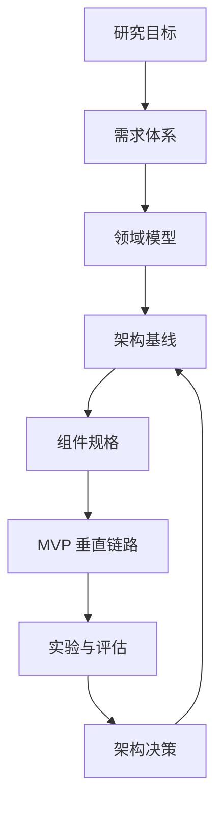

# 项目总览与导航

## 项目定位

Heptalogos 研究面向即时通信场景的 AI 拟人化交互系统。目标不是为模型添加一段角色提示词，而是探索一种能够在真实消息环境中保持**连续性、一致性、自主性、适应性与可控性**的长期运行系统。

## 五条主线

| 主线 | 核心问题 | 入口 |
|---|---|---|
| 交互运行 | 如何处理消息流、时机、打断和非即时响应 | [[02-Requirements/IM-Interaction-Scenarios]] |
| 持续状态 | 如何维持角色、会话、关系和任务状态 | [[03-Domain-Model/State-Model]] |
| 长期记忆 | 如何形成可追溯、可修正、按需出现的记忆 | [[03-Domain-Model/Memory-Model]] |
| 行为与能力 | 如何决定做什么，并安全使用工具完成行为 | [[03-Domain-Model/Persona-and-Behavior]] |
| 科学验证 | 如何证明某种设计真的改善拟人化交互 | [[06-Research/Evaluation-Metrics]] |

## 知识图谱

## 当前基线结论

- 系统核心输入应是**事件流**，而不是封装好的对话轮次。
- 事实记录、状态投影、行为决策、表达生成和输出调度应分离。
- 沉默、等待、取消、反应和主动发言都应是一等行为。
- 记忆应具有来源、时间、置信度、作用域和修正历史。
- 早期实现优先采用模块化单体，保留替换平台、模型和存储的边界。
- 所有关键行为应能通过 Trace 和事件回放复现。
- 正式技术栈为 Python + TypeScript + SQL；Rust 由测量或隔离需求触发，C++ 仅作为外部原生依赖。
- 原始平台事实先落盘，再转换为 Canonical Interaction Event；平台协议类型不得进入认知核心。
- LLBot + Milky 是 QQ 个人号接入的实验性基线，必须通过故障与替换性测试后再决定是否采用。
- Canonical Interaction Gateway 已作为通信基础设施目标基线接受，采用每实例
  Evidence、中央 Fusion/Canonical、可恢复 Feed 和持久化 Intent/Delivery。

## 当前未决议题

- 角色运行状态最小维度及其更新规则。
- 关系状态应该保存事实、统计量还是心理抽象。
- 消息聚合窗口的规则与模型分工。
- 记忆候选何时合并为稳定事实。
- 主动行为的价值函数与打扰预算。
- 多 Agent 是内部实现细节还是一等领域能力。
