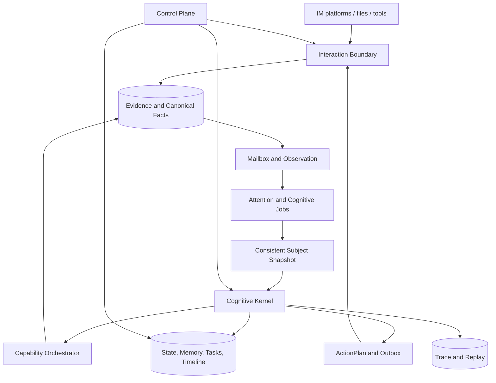

# 系统总览

## 系统形态

Heptalogos 是本机优先、事件驱动、可恢复的长期主体运行系统。早期采用模块化单体；模块通过明确的事实、命令、查询和事件契约协作。



## 核心闭环

```text
外部事件
→ 原始 Evidence
→ Canonical Fact
→ Observation Batch
→ Cognitive Job
→ Subject Snapshot
→ Situation / Context
→ BehaviorIntent
→ State and Action Commit
→ Expression
→ ActionPlan
→ 外部结果
→ 新事实与经历
```

## 主要区域

### Interaction Boundary

负责平台连接、原始采集、规范化、身份与会话边界、资产获取和通信投递。

不负责人格、记忆、行为策略或最终认知。

### Cognitive Kernel

负责选择认知对象、读取一致快照、组织模型任务、形成行为和状态候选、执行审查并统一提交。

模型是内核调用的能力，不是内核本身。

### Subject State

维护身份、Living State、关系、记忆、知识、任务、承诺、日程、生活时间线和自我陈述。每个状态域有明确来源、生命周期和所有者。

### Capability Boundary

发现、授权和执行工具、工作流、浏览器、本地 Worker 与受限子 Agent。结果进入事实流，不能直接修改主体或发送消息。

### Control Plane

提供配置、观察、纠正、审批、维护、回放和生命周期控制。它通过拥有模块的公共接口工作，不跨库解释私有 schema。

### Research Runtime

运行场景、虚拟时间、模型比较、消融和影子实验。在线状态机负责执行，Python 等研究工具负责分析。

## 关键不变量

- 一个实例中的一个核心主体只有一个认知提交权；
- 原始事实先保存，再解释；
- 模型输出不能直接发送；
- 上下文读取不能隐式写长期状态；
- 工具和异步结果重新进入事件流；
- 行为先于表达；
- 作用域先于相关性；
- 外部副作用允许诚实的 `uncertain`；
- 时间通过可替换 Clock；
- 关键过程可以回放和比较。

## 并发模型

可并发：

- 多平台接收；
- raw Evidence 写入；
- 媒体下载和只读分析；
- 只读检索；
- 多个模型候选；
- 工具和子 Agent 执行。

需要串行或版本保护：

- 同一会话的观察和行为；
- 全局主要注意对象选择；
- 主体共享状态提交；
- 关系、任务、时间线和自我陈述；
- 对外行为和高风险工具授权。

## 技术方向

- 目标在线运行时：TypeScript / Node.js；
- 研究与离线认知：Python；
- 原生和安全执行：Rust；
- 事实与状态：SQL / SQLite；
- 管理界面：React / TypeScript。

当前代码仍以 Python 为主，详见 [当前实现](../04-Engineering/Current-Implementation.md)。

## 进一步阅读

- [运行时与数据流](Runtime-and-Dataflow.md)
- [数据与权威边界](Data-and-Authority.md)
- [安全、隐私与控制](Safety-and-Control.md)
- [评估与可观测性](Evaluation-and-Observability.md)
