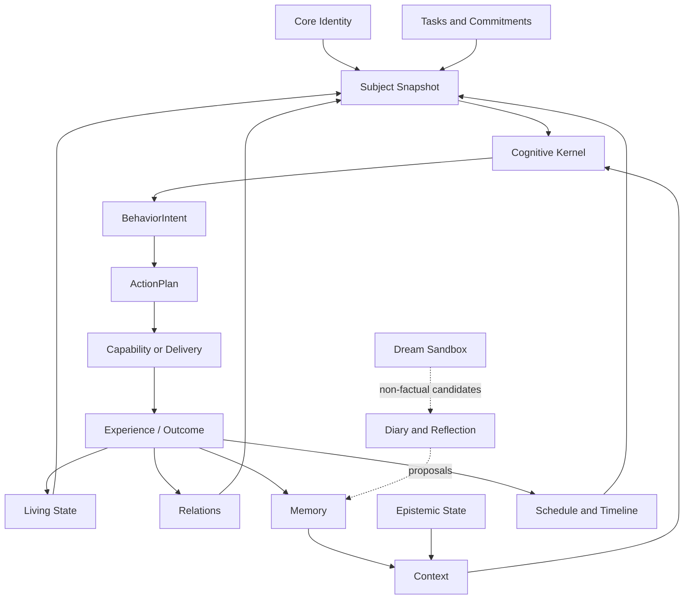

# 概念地图

Heptalogos 的概念围绕一个长期主体组织，而不是围绕框架或服务名称组织。



## 主体

### Core Identity

回答“主体长期是谁”：身份事实、人格基线、价值、边界和自我叙事。

→ [身份与动态状态](Identity-and-Living-State.md)

### Living State

回答“主体此刻怎样”：活动、精力、压力、轻量情绪、目标和注意。

→ [身份与动态状态](Identity-and-Living-State.md)

## 社会与认识

### Relations

共同经历、边界、偏好、未完成事项和主观关系认识；必须有作用域和证据。

→ [关系与社会情境](Relationships-and-Social-Context.md)

### Memory

可以在未来影响认知的有来源经验，不等于原始聊天记录或用户画像。

→ [记忆与知识边界](Memory-and-Knowledge.md)

### Epistemic State

主体知道、相信、熟悉或不知道什么。基础模型的知识不自动属于主体。

→ [记忆与知识边界](Memory-and-Knowledge.md)

## 时间与生活

### Tasks and Commitments

未来需要完成的工作和已经形成的社会义务。

### Planned Schedule

主体计划做什么。

### Lived Timeline

主体实际经历了什么。

### Claim Ledger

主体向不同对象声称了什么。

→ [时间、任务与承诺](Time-Tasks-and-Commitments.md)

## 认知与行为

### Observation Batch

为一次认知聚合的相关事实，不是单条消息。

### Subject Snapshot

一次认知使用的一致状态版本集合。

### Situation Frame

对当前参与者、请求、话题、风险和不确定性的结构化理解。

### BehaviorIntent

主体决定做什么：回复、等待、沉默、反应、询问、工具、取消或主动通知。

### ActionPlan

已经批准、可执行、可取消、可过期的步骤。

### Expression

根据已批准行为和事实生成的自然语言或平台表达。

→ [认知、行为与表达](Cognition-Behavior-and-Expression.md)

## 能力

### Capability

具有输入输出、副作用、权限、成本、取消和幂等语义的受控能力。

### Subagent

受限能力后端，不是独立主体。

→ [能力与子 Agent](Capabilities-and-Subagents.md)

## 离线主观认知

### Diary

对有来源经历的主观整理和候选生成。

### Reflection

从多次经历或反馈形成的高层认识和程序性经验候选。

### Dream

无事实权威、无外部副作用的离线联想沙箱。

→ [日记、反思与梦](Diary-Reflection-and-Dream.md)

## 事实来源标记

重要内容应能区分：

```text
observed
inferred
remembered
imagined
dreamed
```

这些来源具有不同权威，不能在 Prompt 或记忆中被压平。
