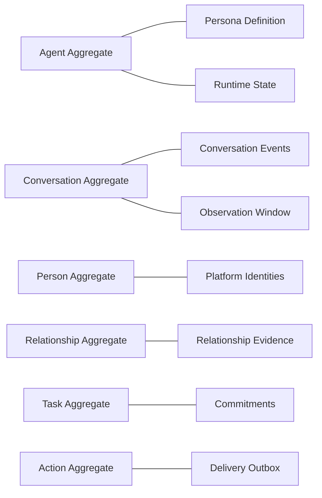

# 领域模型地图

- [[03-Domain-Model/Event-and-Fact-Model|事件与事实模型]]
- [[03-Domain-Model/Identity-and-Conversation|身份与会话]]
- [[03-Domain-Model/State-Model|状态模型]]
- [[03-Domain-Model/Persona-and-Behavior|角色与行为]]
- [[03-Domain-Model/Relationship-Model|关系模型]]
- [[03-Domain-Model/Memory-Model|记忆模型]]
- [[03-Domain-Model/Task-Commitment-and-Autonomy|任务、承诺与自主]]
- [[03-Domain-Model/Action-and-Delivery|行动与投递]]

## 聚合边界候选

