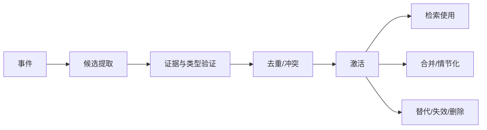

# 记忆模型

## 记忆类型按用途划分

| 类型 | 用途 | 典型保存形式 |
|---|---|---|
| 工作记忆 | 当前决策临时信息 | ContextPacket，不长期保存 |
| 事件记忆 | 发生过的原始事实 | 事件库 |
| 情节记忆 | 一段有时间和参与者的经历 | Episode |
| 人物记忆 | 用户事实、偏好和习惯 | Fact + evidence |
| 关系记忆 | 共同经历和边界 | Relationship evidence |
| 语义记忆 | 稳定知识 | Knowledge item |
| 承诺记忆 | 未来应履行的事项 | Task/Commitment 实体 |
| 程序记忆 | 可复用策略和技能经验 | Skill/Policy evidence |
| 自我记忆 | Agent 自身行动与结果 | Trace-derived episode |

## 记忆记录

```yaml
memory_id: uuid
memory_type: enum
subject_refs: []
content: structured object
valid_from: datetime?
valid_to: datetime?
observed_at: datetime
source_event_ids: []
extractor_version: string
confidence: 0..1
salience: 0..1
scope: private | conversation | group | public
sensitivity: level
status: candidate | active | disputed | superseded | deleted
supersedes: []
conflicts_with: []
```

## 生命周期



## 检索不是一次向量搜索

候选集合应先按人物、会话、作用域、有效时间和敏感策略过滤，再组合关键词、语义、事件关系、任务关系和时间邻近。排序结果必须保留被选中的原因。

## 用户画像

画像是面向上下文或管理界面的物化视图。它不能覆盖底层证据，也不能让模型用一次写操作重写全部用户事实。
