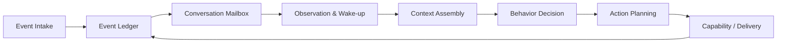

# 架构基线 v0.1

## 架构风格

当前推荐：**具有事件溯源思想、按会话串行化和六边形边界的模块化单体**。

这不是要求完整实现 Event Sourcing，而是规定：关键外部事实和行为结果使用追加式事件记录；状态快照作为投影；模块通过应用接口和事件契约协作。

## 核心闭环

## 层次

1. **边缘接入**：平台、媒体、身份和原始载荷。
2. **事件与运行内核**：事件库、分区路由、Mailbox、状态投影。
3. **反应处理**：消息窗口、唤醒、等待、静默和打断。
4. **上下文与认知**：上下文组装、行为策略、规划和表达。
5. **能力与调度**：工具、任务、主动机会、Outbox 和投递。
6. **记忆与治理**：候选、证据、检索、维护和用户控制。
7. **研究基础设施**：Trace、回放、场景、指标和实验版本。

## 关键边界

- 适配器不能决定人格或记忆；
- 上下文构建器不能直接写长期状态；
- 模型输出不能直接发送；
- 工具结果不能绕过事件库；
- 关系状态不能直接授权高风险能力；
- 评估必须覆盖系统组合而非只测模型。
