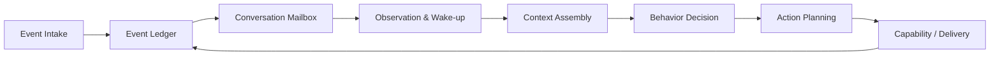

# 架构基线 v0.2

## 架构风格

当前推荐：**具有事件溯源思想、按会话串行化和六边形边界的模块化单体**。

这不是要求完整实现 Event Sourcing，而是规定：关键外部事实和行为结果使用追加式事件记录；状态快照作为投影；模块通过应用接口和事件契约协作。

## 核心闭环

## 层次

1. **边缘接入**：平台、媒体、身份和原始载荷。
2. **事件与运行内核**：事件库、分区路由、Mailbox、状态投影。
3. **反应处理**：消息窗口、唤醒、等待、静默和打断。
4. **上下文与认知**：上下文组装、行为策略、规划和表达。
5. **能力与调度**：工具、任务、主动机会、Outbox 和投递。
6. **记忆与治理**：候选、证据、检索、维护和用户控制。
7. **研究基础设施**：Trace、回放、场景、指标和实验版本。

## 关键边界

- 适配器不能决定人格或记忆；
- 上下文构建器不能直接写长期状态；
- 模型输出不能直接发送；
- 工具结果不能绕过事件库；
- 关系状态不能直接授权高风险能力；
- 评估必须覆盖系统组合而非只测模型。

## 技术与协议基线

- Python 是早期认知运行时和实验主语言，TypeScript 用于控制面，SQL 是可追溯数据基础；参见 [[08-ADR/ADR-0009-Programming-Language-and-Runtime-Policy]]。
- 平台协议实现先进入 Raw Event Ledger，再转换为 Canonical Interaction Event；参见 [[08-ADR/ADR-0010-Platform-Adapter-Boundary-and-Canonical-Interaction-Events]]。
- LLBot + Milky 仅是 QQ 个人号接入的 proposed 实验基线，不改变平台中立核心；参见 [[08-ADR/ADR-0011-Milky-Experimental-QQ-Edge-Protocol]]。
- IM 边界采用 Adapter Evidence、Fusion、Canonical Ledger、Reactor Feed、
  Outbound Intent、Delivery Plan/Outcome 分层；参见
  [[08-ADR/ADR-0012-Canonical-Interaction-Gateway]]。
- 第一版部署为 `heptalogos-interaction` 单代码包、多运行角色；每个 Adapter
  Instance 使用独立 Evidence SQLite，中央 Gateway 使用独立 SQLite。

## Interaction Gateway 当前运行基线

`run all` 用一个顶层 `TaskGroup` 监督 Gateway 与所有 Adapter role。每个 Adapter
连接内先启动 raw capture，再验证账号/协议版本、执行持久历史恢复，最后启动
delivery、asset 和 heartbeat worker。连接失败只使该实例进入 unhealthy 并退避
重连；其他来源和已落盘 Evidence 仍可继续 Fusion。

部署合并不等于权威合并。角色之间通过 Evidence/Gateway SQLite 的 cursor、lease
和 checkpoint 协作，不依赖内存队列作为唯一交接。完整机制见
`modules/interaction/docs/architecture.md`。

## 设计取舍

当前基线优先保证可解释故障和可重放数据，而不是追求表面上的低延迟或 exactly-once。
系统允许重复读取并要求幂等提交；对平台调用则在 request evidence 后停止自动重试，
因为“可能成功”不能安全降格为“失败”。
