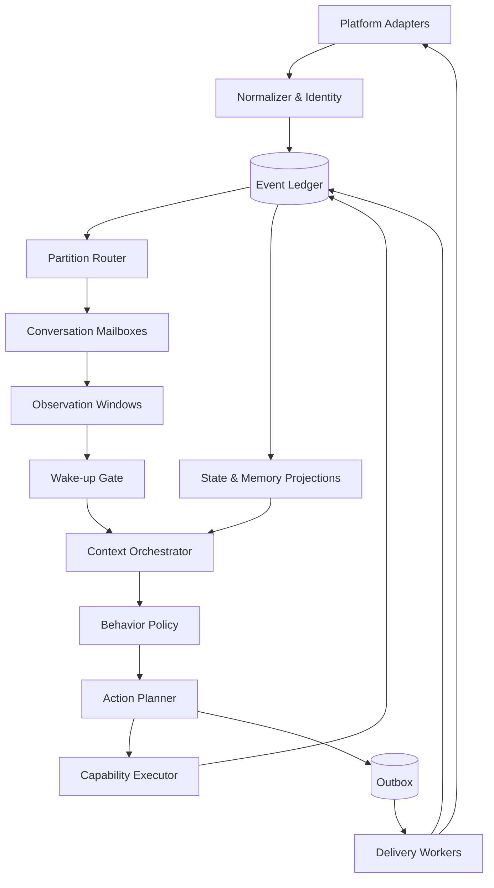

# 运行时拓扑

## 逻辑拓扑

## 进程建议

MVP 可以只有三个进程或运行角色：

- `runtime`：接入、Mailbox、决策和调度；
- `worker`：媒体、记忆维护和长任务；
- `control/replay`：管理 API、诊断和评估。

它们可以共享同一代码库和数据库。只有在负载、隔离或团队边界明确后再拆服务。

## 串行与并行

- 同一 `agent_id + conversation_id` 串行；
- 不同会话可以并行；
- 人物和关系共享状态用版本控制；
- 媒体、Embedding 和长工具并行但结果事件化；
- 发送按平台账号和会话顺序约束。
