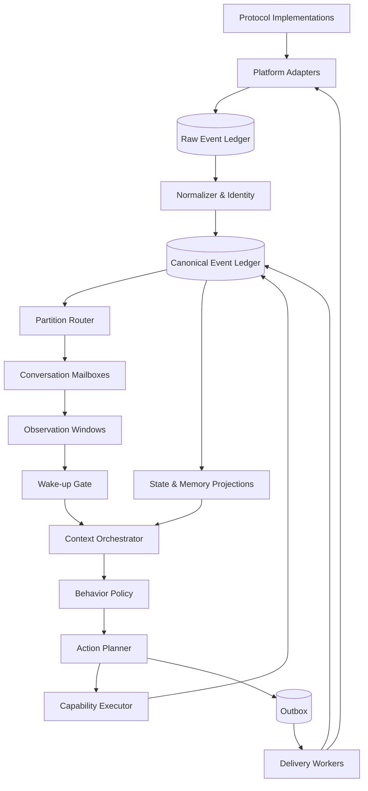

# 运行时拓扑

## 逻辑拓扑



## 进程建议

MVP 可以只有三个进程或运行角色：

- `runtime`：接入、Mailbox、决策和调度；
- `worker`：媒体、记忆维护和长任务；
- `control/replay`：管理 API、诊断和评估。

它们可以共享同一代码库和数据库。只有在负载、隔离或团队边界明确后再拆服务。

Interaction Gateway 第一版由同一 `heptalogos-interaction` 包提供：

- `adapter`：单 Adapter Instance 的 ingress、history、asset 与 delivery executor；
- `gateway`：Fusion、Canonical、Reactor Feed、Routing 和 Outcome；
- `all`：开发和单机运行时监督所有已配置角色。

每个 Adapter Instance 独立失败；`all` 模式仍通过同一 TaskGroup 监督关键任务。

### 当前监督树

```text
InteractionApp.run_all
├── gateway: poll Evidence sources and commit Fusion
├── adapter:<id>
│   ├── capture (starts before identity checks)
│   ├── verify identity and protocol version
│   ├── persistent history recovery
│   ├── delivery worker
│   ├── asset worker
│   ├── heartbeat
│   └── stop watcher
└── adapter:<id> ...
```

Adapter 的连接级异常会关闭 client、写 unhealthy heartbeat 并以 1 到 30 秒指数退避
重连。`run all` 的进程级关键任务由 TaskGroup 监督，避免 worker 静默死亡而窗口仍
看似运行。独立部署时同样以数据库为交接边界。

MVP 默认由 Python 运行时直接承载薄适配器。TypeScript Gateway 只有在平台 SDK、独立部署、权限或故障域形成明确边界时引入；语言本身不是拆分理由。

QQ 个人号实验拓扑为：

```text
LLBot → Milky HTTP/WebSocket → adapter role → Evidence SQLite
      → gateway role/Fusion → Canonical Ledger → Reactor Feed
```

LLBot 和 Milky 类型都不得穿过 Platform Adapter 边界。

## 串行与并行

- 同一 `agent_id + conversation_id` 串行；
- 不同会话可以并行；
- 人物和关系共享状态用版本控制；
- 媒体、Embedding 和长工具并行但结果事件化；
- 发送按平台账号和会话顺序约束。
