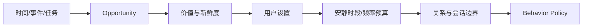

# 调度与主动行为

## 两类调度

### 响应调度

控制已经形成的 ActionPlan：打字延迟、分段、引用、最早发送、过期和新消息取消。

### 自主唤醒调度

控制未来重新进入行为决策：承诺到期、任务完成、条件变化和周期检查。

两者不能混为一个 Cron 列表。

## 持久化调度记录

```yaml
schedule_id: uuid
trigger_type: at | after | event_condition | periodic
trigger_spec: object
action_reference: id?
wakeup_payload: object
status: active | fired | cancelled | expired
next_fire_at: datetime
policy_version: string
```

## 主动机会管线



## 默认保守策略

早期系统只主动履行明确承诺和用户设置的提醒。基于推断兴趣或关系的主动发言属于后续实验能力。
