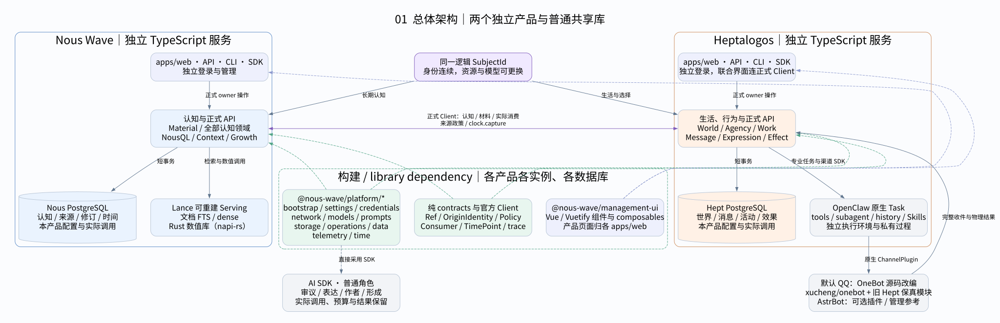
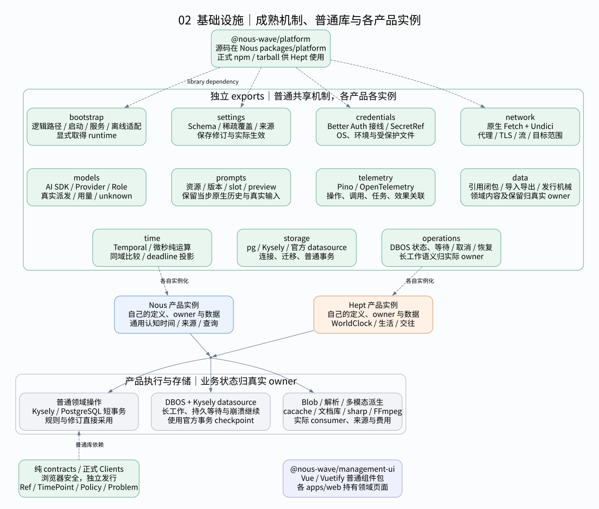
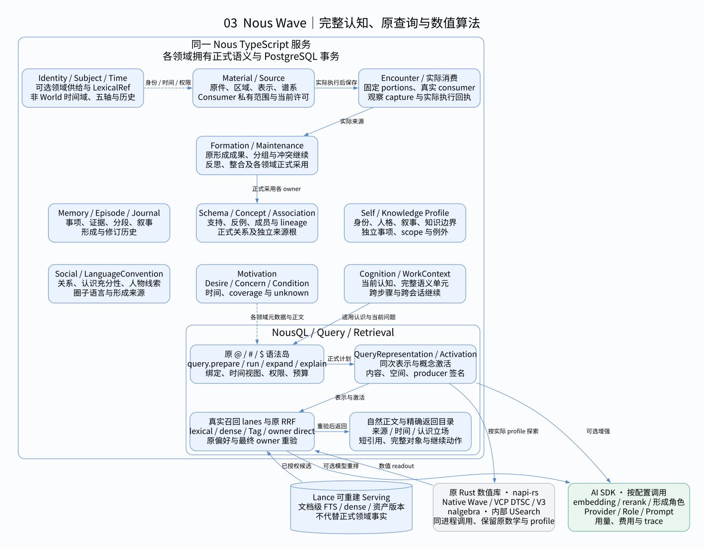
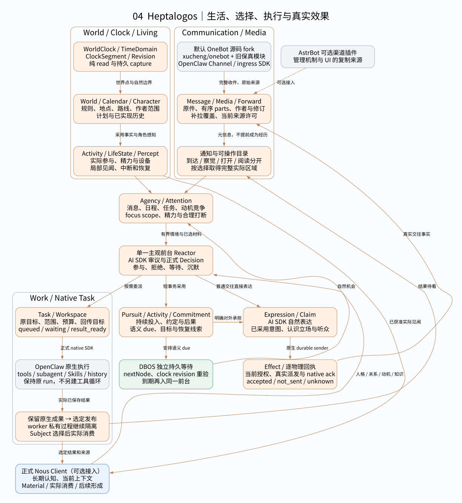
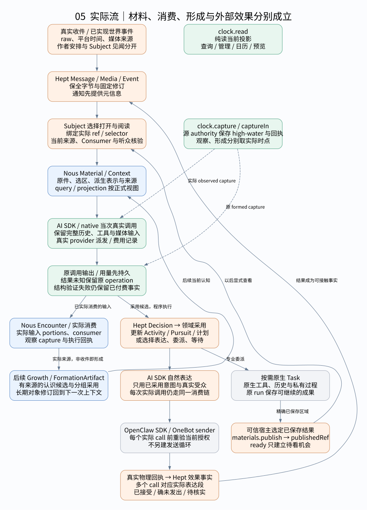
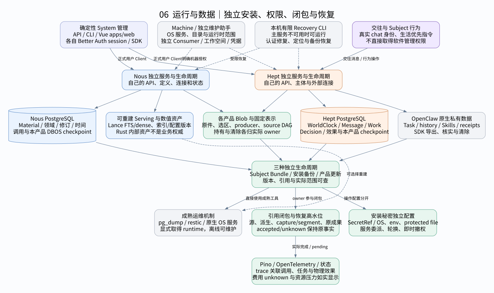

# Nous Wave × Heptalogos · 系统架构图集

六张图使用当前 Spec 的同一套所有权：两个独立 TypeScript 产品及数据库，普通共享库和正式 Clients，原生执行与真实外部效果。

[打开离线查看器](架构图集.html)。切换、缩放、拖动和来源链接均在本地工作。绿色虚线表示构建/普通库依赖，实线标签说明运行调用或事实交接。

## 1. 总体架构

两个独立 TypeScript 产品和数据库，通过正式 Client 协作；platform、contracts 与 management-ui 是构建和普通库依赖。

[编辑 DOT 源](src/01-总体架构.dot) · [整体架构与模块合同](../设计/整体架构与模块合同.md) · [能力保全与现有代码纠偏](../设计/能力保全与现有代码纠偏.md) · [共同值与调用上下文](../设计/基础设施/共同值与调用上下文.md)

## 2. 基础设施

各产品各自实例化共享库。普通领域直接短事务；DBOS 承担长工作、持久等待与恢复，成熟依赖承担网络、模型、媒体和观测。

[编辑 DOT 源](src/02-基础服务.dot) · [存储事务与缓存](../设计/基础设施/存储事务与缓存.md) · [配置与生效](../设计/基础设施/配置与生效.md) · [网络与外部资源](../设计/基础设施/网络与外部资源.md) · [模型供应与调用](../设计/基础设施/模型供应与调用.md) · [时间与调度](../设计/基础设施/时间与调度.md)

## 3. Nous Wave

保全全部认知领域、原 NousQL、Lance 文档 FTS/dense 和原 Rust 数值库。napi-rs 调用的数值库保留 Native/VCP、nalgebra 与内部 USearch。

[编辑 DOT 源](src/03-Nous-Wave.dot) · [NousQL与检索合同](../设计/NousQL与检索合同.md) · [检索服务与认知消费者](../设计/基础设施/检索服务与认知消费者.md) · [能力保全与现有代码纠偏](../设计/能力保全与现有代码纠偏.md)

## 4. Heptalogos

Hept 拥有世界映射、生活、注意、活动、追求、交往和效果。普通审议/表达使用 AI SDK；专业工作和 QQ 通信复用 OpenClaw 原生能力。

[编辑 DOT 源](src/04-Heptalogos.dot) · [时间与调度](../设计/基础设施/时间与调度.md) · [媒体与材料基础](../设计/基础设施/媒体与材料基础.md) · [模型供应与调用](../设计/基础设施/模型供应与调用.md)

## 5. 跨系统实际流

收件和保全形成材料；每次实际执行后记录消费，后续才形成长期认知。表达采用、专业执行与逐物理效果分开，clock.read 和 clock.capture 各有边界。

[编辑 DOT 源](src/05-跨系统流.dot) · [媒体与材料基础](../设计/基础设施/媒体与材料基础.md) · [Prompt与上下文](../设计/基础设施/Prompt与上下文.md) · [身份权限与密钥](../设计/基础设施/身份权限与密钥.md) · [时间与调度](../设计/基础设施/时间与调度.md)

## 6. 运行与数据

交往、System、Machine 与 Recovery 权限独立。两产品数据、原生私有记录与可重建资产分别管理，生命周期保存来源、时间回执和已发生效果的闭包。

[编辑 DOT 源](src/06-运行与管理.dot) · [安装与生命周期](../设计/基础设施/安装与生命周期.md) · [身份权限与密钥](../设计/基础设施/身份权限与密钥.md) · [管理呈现与扩展](../设计/基础设施/管理呈现与扩展.md) · [数据生命周期与发行](../设计/基础设施/数据生命周期与发行.md) · [观测错误与诊断](../设计/基础设施/观测错误与诊断.md)

## 所有权与阅读规则

- platform、contracts、Client、management-ui 为普通构建依赖，各产品单独实例化；共享 UI 使用 Vue/Vuetify，领域页面归各 apps/web。
- AI SDK 承担普通角色调用；OpenClaw 承担专业 Task、工具、历史、Skills 和原生渠道。默认 QQ 为 OneBot 源码改编，AstrBot 保留可选接入及管理参考。
- Lance 承担文档级 FTS/dense；原 Rust 数值库经 napi-rs 在 Nous 进程内调用，保留 Native/VCP、nalgebra 和内部 USearch。
- Material 保全、实际消费和后续形成分别记录。世界/行为领域、原生执行及外部效果各有实际 owner。
- clock.read 只读投影；capture/captureIn 保存源高水位与时间回执。DBOS 承担持久等待、长工作和恢复，普通领域直接短事务。

## 依据

[项目宪纲](../项目宪纲.md)与各图列出的当前设计文档。图展示目标责任，实际实施和验证进度见[研究入口](../研究/README.md)。
