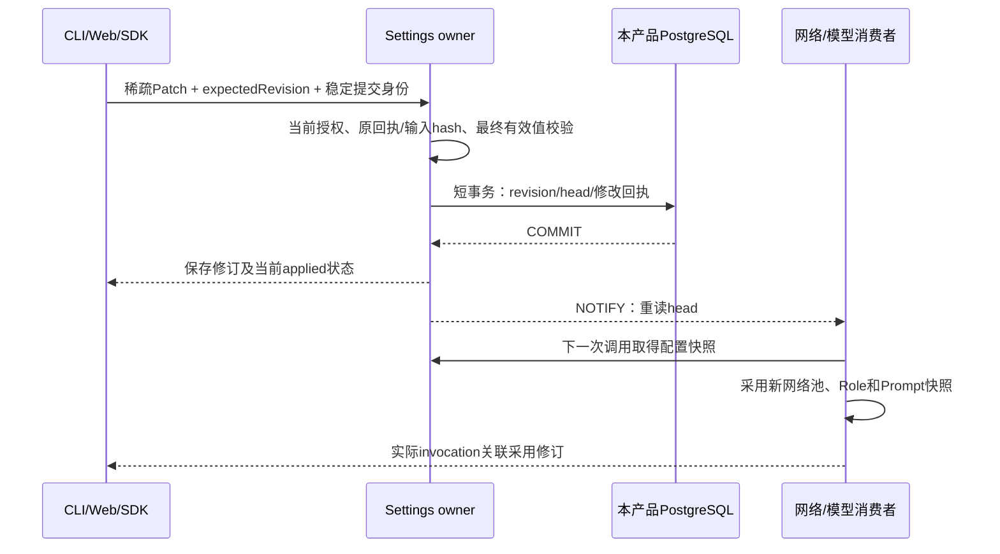
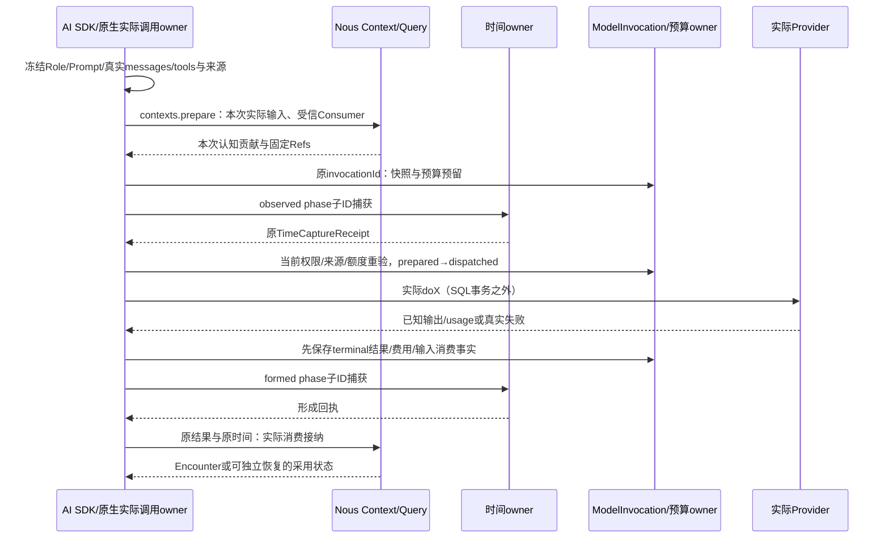
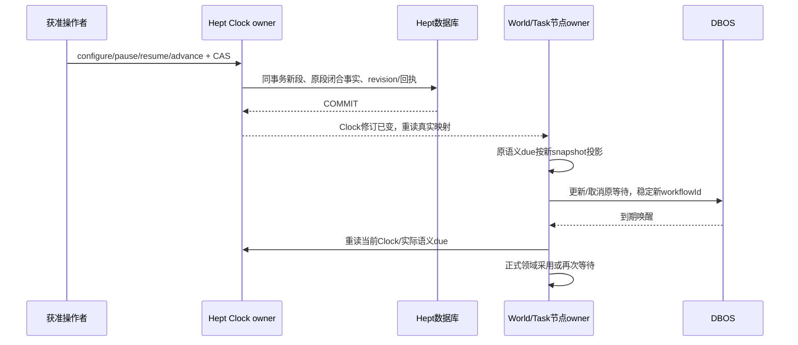
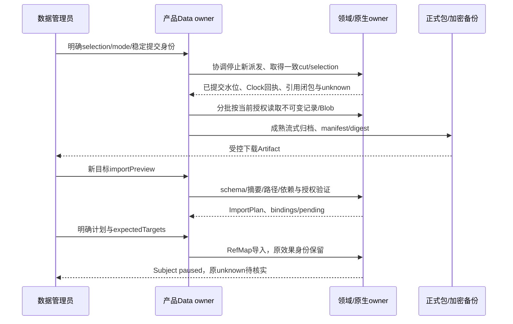

# 系统图与关键时序

六张系统图只有一份正式源，位于[图集](Nous-Heptalogos-Architecture-Atlas/README.md)：

| 图 | 当前责任 |
|---|---|
| [总体架构](Nous-Heptalogos-Architecture-Atlas/svg/01-总体架构.svg) | 两产品、独立数据库、正式SDK与普通共享库 |
| [基础服务](Nous-Heptalogos-Architecture-Atlas/svg/02-基础服务.svg) | 配置/权限/网络/模型/Prompt/存储/执行/时间/诊断的实际依赖 |
| [Nous](Nous-Heptalogos-Architecture-Atlas/svg/03-Nous-Wave.svg) | 全部认知领域、NousQL/Serving、来源与形成 |
| [Hept](Nous-Heptalogos-Architecture-Atlas/svg/04-Heptalogos.svg) | 世界生活、全局注意、任务、表达与逐物理效果 |
| [跨系统流](Nous-Heptalogos-Architecture-Atlas/svg/05-跨系统流.svg) | 原始收件、选定材料、实际调用/消费、认知与结果回流 |
| [运行与管理](Nous-Heptalogos-Architecture-Atlas/svg/06-运行与管理.svg) | Bootstrap/Host/Subject、独立/联合管理、备份/恢复与发行 |

[离线HTML](Nous-Heptalogos-Architecture-Atlas/架构图集.html)内嵌六图，支持缩放、模块链接和键盘切页。下面时序补充真实提交边界，类型与各专题一致。

## 配置变更到下次调用

默认值在所有稀疏覆盖合并后一次补齐；通知丢失重连后重读。保存成功与运行应用失败分别显示，见[配置](设计/基础设施/配置与生效.md)。

## 一次真实模型调用

observed捕获本身不是已读经历，not_sent不造Encounter。terminal保存后时间/采用失败只继续语义收尾；dispatched而无已知结果保留unknown并核实原调用。后台Consumer不写成主体消费。跨产品根Task先由Hept分配有币种硬上限的子额度，Nous唯一记录自己的实际Provider费用，见[模型](设计/基础设施/模型供应与调用.md)。

## 改钟与待办重投影

read/projectDeadline是纯运算；真实观察、形成和效果另行capture。跨产品修订通知只触发重新读取来源，不成为第二份时钟权威。五轴、历史可知范围、离线、DST与暂停语义见[时间](设计/基础设施/时间与调度.md)。

## 导出与恢复

Subject Bundle、Installation Backup与Software Release分别处理。完整OpenClaw安装备份含凭据，须显式选择并加密；单主体用原生窄scope操作。恢复不重发效果、不把旧预算回执重映射为新授权。详见[数据生命周期](设计/基础设施/数据生命周期与发行.md)。
